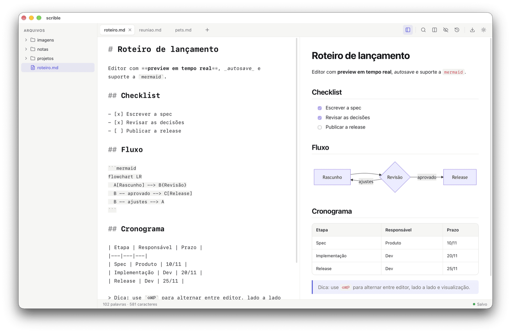
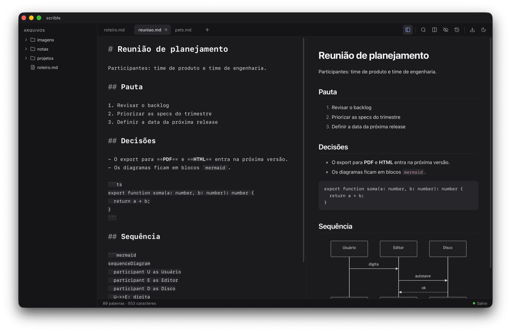
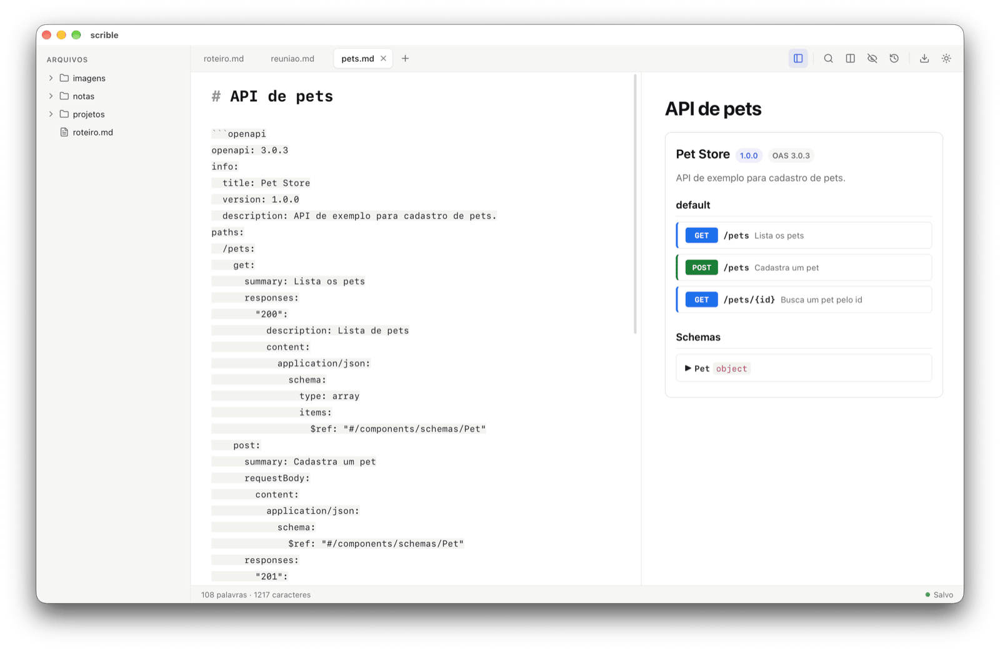
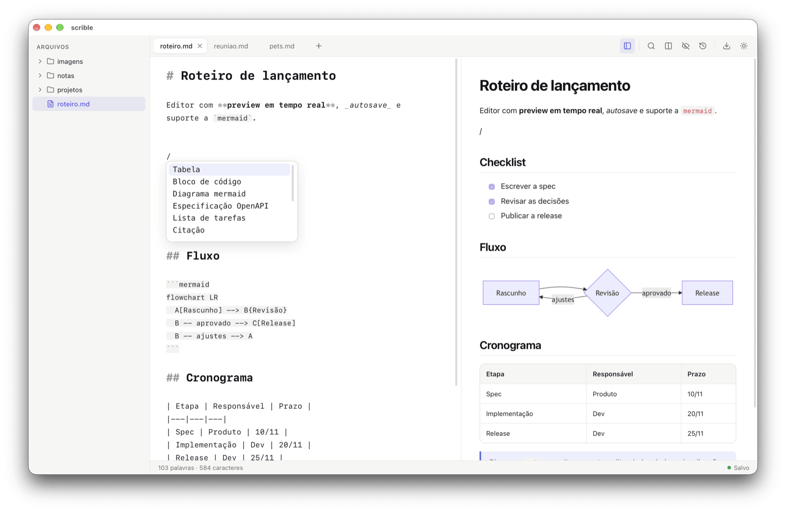
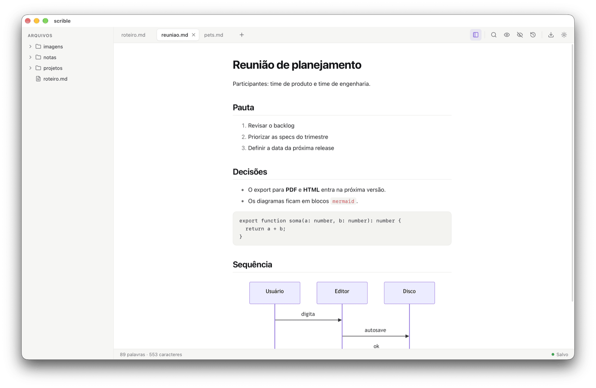

# scrible

[](https://github.com/eduardohitek/scrible/actions/workflows/ci.yml)
[](https://github.com/eduardohitek/scrible/releases)

Editor de markdown com interface limpa, preview em tempo real (incluindo diagramas [mermaid](https://mermaid.js.org/) e especificações OpenAPI) e autosave direto no arquivo. Roda no macOS e no Linux.



## Funcionalidades

- **Preview em tempo real**, lado a lado com o editor e com a rolagem sincronizada. O preview cobre GFM (tabelas, listas de tarefas), front matter, notas de rodapé e diagramas mermaid. ⇧⌘P alterna entre três modos: só editor, lado a lado e só visualização.
- **Preview inline no editor**: títulos, negrito, itálico e código aparecem estilizados enquanto você digita. O botão de marcadores na toolbar esconde a sintaxe markdown fora da linha do cursor.
- **Autosave direto no arquivo**, sem botão de salvar. A status bar mostra se o documento está salvo. Se o arquivo for alterado por outro programa, o scrible avisa e você escolhe qual versão manter.
- **Histórico de versões** de cada documento, com restauração pela toolbar.
- **Abas**: dá para abrir, fechar, reordenar arrastando e renomear. Com muitas abas abertas, a roda do mouse rola a barra e uma lista mostra todas. A sessão é restaurada quando o app abre.
- **Explorador de arquivos** lateral (⇧⌘E), com menu de contexto para criar, renomear e apagar arquivos e pastas.
- **Autocomplete**: digite `/` no começo de uma linha para abrir o menu de blocos (tabela, código, mermaid, OpenAPI, lista de tarefas, títulos…). O editor fecha pares e continua listas sozinho, sugere linguagens nos blocos de código e completa caminhos de links e imagens.
- **Especificações OpenAPI/Swagger** num bloco ` ```openapi `, renderizadas no preview com endpoints e uma árvore de schemas.
- **Busca e substituição** (⌘F).
- **Exportar para HTML e PDF**, com os diagramas e os blocos OpenAPI já renderizados.
- **Tema claro, escuro ou do sistema** e **zoom da interface** (⌘= / ⌘- / ⌘0).
- **Atualizações automáticas** (ver [Atualizações](#atualizações)).

| | |
|---|---|
|  |  |
| Tema escuro | Especificação OpenAPI no preview |
|  |  |
| Menu de blocos (`/`) | Explorador e modo só visualização |

## Download e instalação

Os builds ficam na [página de releases](https://github.com/eduardohitek/scrible/releases). Escolha o arquivo da sua plataforma:

| Plataforma | Arquivo | Atualiza sozinho |
|---|---|---|
| macOS (Apple Silicon) | `scrible_*_aarch64.dmg` | sim |
| Linux x64 / arm64 (Ubuntu 22.04+ e derivadas) | `scrible_*_amd64.AppImage` / `scrible_*_aarch64.AppImage` | sim |
| Linux x64 / arm64 (Debian/Ubuntu) | `scrible_*_amd64.deb` / `scrible_*_arm64.deb` | não, instale o `.deb` novo |

- **macOS**: só Apple Silicon (arm64).
- **Linux**: x64 e arm64. A v0.12.0 saiu sem builds de Linux, que voltaram na v0.12.1. Quem ficou na v0.11.0 pelo AppImage recebe a atualização pelo próprio app.
- **Windows** não é mais publicado. A última versão para ele é a [v0.11.0](https://github.com/eduardohitek/scrible/releases/tag/v0.11.0), e quem a instalou não recebe atualizações novas. Ainda dá para buildar o app no Windows a partir do código-fonte (ver [Pré-requisitos](#pré-requisitos)).

**macOS**: o app tem assinatura ad-hoc, sem notarização ([#28](https://github.com/eduardohitek/scrible/issues/28)), então o sistema avisa na primeira abertura:

1. Abra o `.dmg` e arraste o `scrible.app` para `Applications`.
2. Tente abrir o app. O macOS vai bloquear.
3. Vá em **Ajustes do Sistema → Privacidade e Segurança**, role até a mensagem sobre o scrible e clique em **Abrir Mesmo Assim**.

**Linux**: AppImage, `chmod +x scrible_*.AppImage` e execute. Pacote `.deb`, `sudo apt install ./scrible_*.deb`.

Cada release traz um `SHA256SUMS.txt` para conferir a integridade do download:

```sh
shasum -a 256 -c SHA256SUMS.txt --ignore-missing   # macOS
sha256sum -c SHA256SUMS.txt --ignore-missing       # Linux
```

### Atualizações

O scrible confere sozinho, ao abrir, se há uma versão nova. Também dá para conferir pelo menu **scrible → Procurar atualizações…**. Ao confirmar no aviso, ele salva as abas, baixa, instala e reinicia. Quem está numa versão anterior ao updater precisa instalar o pacote da plataforma uma última vez. Instalações via `.deb` não se atualizam pelo app.

## Uso

### Onde os arquivos ficam

O scrible lê e grava os arquivos do usuário em `~/Documents/scrible/`, que é a pasta mostrada no explorador. Os dados internos do app (sessão, configurações, histórico de versões) ficam em `~/Documents/scrible/.scrible/`.

Um documento novo (⌘T) nasce como `untitled.md` (ou `untitled-N.md`) nessa pasta, ou na pasta escolhida pelo explorador. O primeiro ⌘S abre o diálogo para escolher nome e lugar e move o arquivo para lá. Depois disso, o autosave cuida do resto. **Salvar Como…** (⇧⌘S) grava uma cópia, e a aba passa a editar a cópia.

### Abrir arquivos pelo Finder (macOS)

Depois de instalado, o scrible aparece em **Abrir com** (botão direito num `.md` ou `.markdown` no Finder). Também dá para arrastar arquivos para o ícone do scrible no Dock. Com o app fechado, a sessão anterior é restaurada e o arquivo entra como aba ativa. Com ele aberto, o arquivo abre numa aba nova (ou foca a aba, se já estiver aberto). Selecionar vários arquivos abre uma aba para cada.

O scrible **não** vira o app padrão de Markdown sozinho. Para torná-lo padrão: selecione um `.md` no Finder → **Arquivo → Obter Informações** (⌘I) → **Abrir com** → escolha o scrible → **Alterar Tudo…**. Se ele não aparecer na lista logo depois de instalar, abra o app uma vez. Se o ícone no Dock não aceitar arquivos arrastados logo depois de instalar ou atualizar, o Dock ainda está com a versão antiga em cache: rode `killall Dock` (ele reabre sozinho).

### Atalhos

No Linux, use Ctrl no lugar de ⌘.

| Atalho | Ação |
|---|---|
| ⌘T | Documento novo |
| ⌘O | Abrir arquivo |
| ⌘S | Salvar (escolhe o destino de um documento novo) |
| ⇧⌘S | Salvar Como… |
| ⌘W | Fechar aba |
| ⌘F | Buscar e substituir |
| ⇧⌘P | Alternar modo de exibição (editor, lado a lado, visualização) |
| ⇧⌘E | Mostrar/esconder o explorador |
| ⌘= / ⌘- / ⌘0 | Aumentar, diminuir e restaurar o zoom |
| `/` | Menu de blocos (no começo de uma linha) |

Renomear a aba, exportar para HTML/PDF e trocar o tema ficam nos menus **Arquivo** e **Visualizar**.

## Desenvolvimento

### Stack

- [Tauri v2](https://v2.tauri.app/) (backend Rust) + [React](https://react.dev/) + [TypeScript](https://www.typescriptlang.org/) + [Vite](https://vite.dev/)
- [CodeMirror 6](https://codemirror.net/) como engine de edição
- [markdown-it](https://github.com/markdown-it/markdown-it) + [mermaid](https://mermaid.js.org/) + [DOMPurify](https://github.com/cure53/DOMPurify) no pipeline de preview
- [Zustand](https://zustand.docs.pmnd.rs/) para o estado global
- [mise](https://mise.jdx.dev/) gerencia as versões de Node e Rust e expõe os comandos do projeto como tasks

### Pré-requisitos

- [mise](https://mise.jdx.dev/getting-started.html) instalado
- No macOS, as Xcode Command Line Tools (exigidas pelo Tauri, não instaladas pelo mise):
  ```sh
  xcode-select --install
  ```
- No Linux (Debian/Ubuntu), as bibliotecas do WebKitGTK:
  ```sh
  sudo apt install libwebkit2gtk-4.1-dev libgtk-3-dev librsvg2-dev libayatana-appindicator3-dev patchelf
  ```
- No Windows, o WebView2 (já vem no Windows 11) e as Build Tools do Visual Studio com "Desenvolvimento para desktop com C++".

### Como rodar

```sh
mise install   # instala Node e Rust nas versões fixadas em mise.toml
mise run setup # instala dependências npm e do Cargo
mise run dev   # abre o app em modo desenvolvimento com hot reload
```

### Tasks disponíveis

Rode `mise tasks` para a lista completa. As principais:

| Task | O que faz |
|---|---|
| `mise run dev` | Roda o app em modo desenvolvimento |
| `mise run build` | Compila e gera os instaladores da plataforma atual (`.app`/`.dmg`, `.exe`, `.AppImage`/`.deb`) e o pacote do updater. Exige a chave em `TAURI_SIGNING_PRIVATE_KEY` |
| `mise run lint` | ESLint no frontend + `cargo clippy` no backend |
| `mise run typecheck` | Verifica os tipos do TypeScript |
| `mise run test` | Testes do frontend (Vitest) e do backend (`cargo test`) |
| `mise run release <versão>` | Prepara o bump de versão numa branch `chore/release-vX.Y.Z` (chamado pela skill `/release`, ver `CLAUDE.md`) |
| `mise run tag` | Fallback manual: cria e envia a tag da versão atual, disparando a release. No fluxo normal isso acontece sozinho depois do merge do PR de release |

### Estrutura do projeto

```
scrible/
├── src-tauri/      # backend Rust: arquivos, autosave, watchers, histórico, sessão, menu nativo, export PDF
├── src/
│   ├── editor/     # CodeMirror: montagem, autocomplete, menu /, decorations do preview inline
│   ├── preview/    # pipeline markdown-it + mermaid + OpenAPI + sanitização
│   ├── layout/     # split redimensionável e sincronização de rolagem
│   ├── tabs/       # barra de abas
│   ├── explorer/   # árvore de arquivos
│   ├── history/    # painel de histórico de versões
│   ├── conflict/   # aviso de alteração externa
│   ├── export/     # export HTML/PDF
│   ├── session/    # persistência das abas
│   ├── settings/   # configurações do app
│   ├── updater/    # checagem e instalação de atualizações
│   ├── ui/         # toolbar e status bar
│   ├── theme/      # tokens de tema claro/escuro
│   └── store/      # estado global (Zustand)
├── docs/screenshots/  # imagens deste README
└── mise.toml       # versões de ferramentas e tasks do projeto
```

## Contribuindo

O backlog está nas [issues do repositório](https://github.com/eduardohitek/scrible/issues). Funcionalidades novas entram como specs (issues com o label [`spec`](https://github.com/eduardohitek/scrible/issues?q=label%3Aspec)), divididas em sub-issues. O fluxo de trabalho e as convenções estão em [`CLAUDE.md`](CLAUDE.md), e as decisões de arquitetura em [`DECISIONS.md`](DECISIONS.md).
